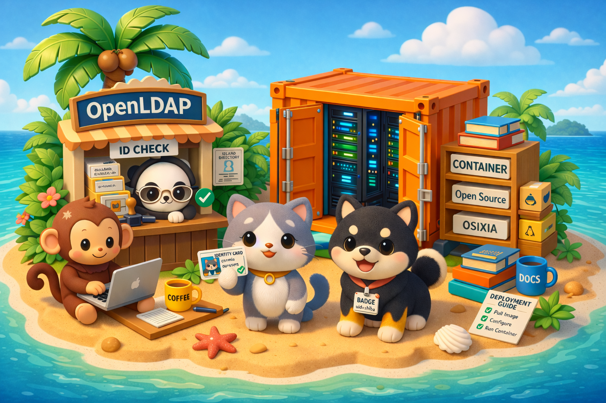

# osixia/openldap

[docker hub]: https://hub.docker.com/r/osixia/openldap
[github]: https://github.com/osixia/container-openldap

[][docker hub]
[][docker hub]
[][github]

[OpenLDAP](https://www.openldap.org/) container image with built-in bootstrap, backup helpers, TLS, replication and upgrade support.

110M+ pulls 🎉 Thanks to everyone using, testing, reporting issues, and contributing to this image. 🙏

!!! warning "v2 is a breaking release"

    Existing v1 deployments are **not** migrated automatically and require a **manual migration** to move to v2.
    Automatic upgrade paths are intended only between v2 versions (for example, v2.x to v2.y). See [Upgrade](upgrade.md).

## Start Here

- New to `osixia/openldap`? Start with the [Quickstart](quickstart.md) to run a first server.
- Want to understand what happens at startup? Read [How It Works](how-it-works.md).
- Preparing a first deployment? See [Bootstrap](bootstrap/index.md), then [TLS](tls.md) and [Replication](replication.md).
- Running it in production? Read [Backup / Restore](backup-restore.md) and [Upgrade](upgrade.md).
- Looking for a setting? All of them are listed in [Environment Variables](environment-variables.md).

This image is based on [osixia/baseimage](../baseimage/index.md).
