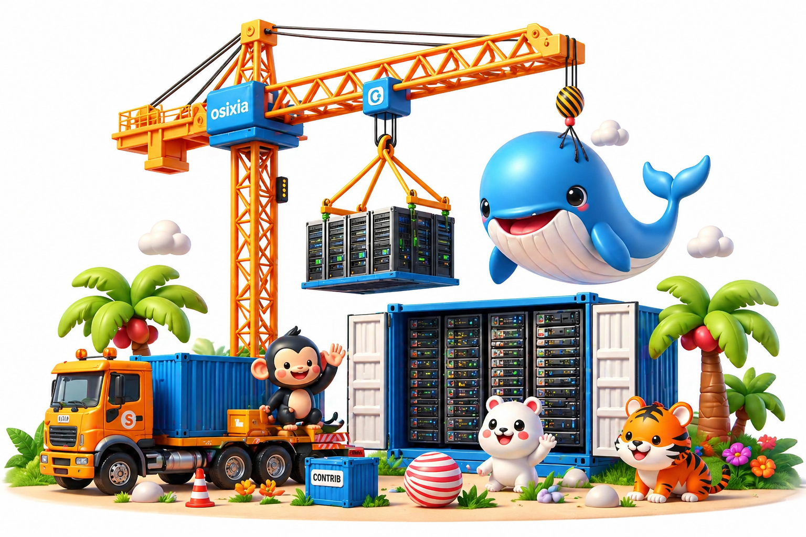

---
hide:
  - footer
---
# Projects

- **[Container images](container-images/index.md)**

    Build container images with baseimage, share virtual IPs with Keepalived, or run an OpenLDAP directory.

- **[Kubernetes](kubernetes/index.md)**

    Detect VIP routing and TCP connectivity on your nodes, or deploy OpenLDAP and phpLDAPadmin with Helm.

[Build & CI](build-and-ci/index.md): build and test container images with dagger-build.

