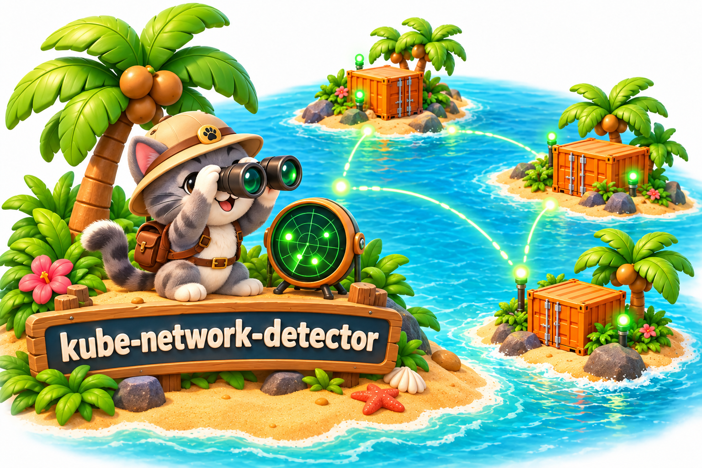

# kube-network-detector

Find which Kubernetes node receives traffic for a virtual IP, or which nodes can reach a TCP endpoint. The detector records the result as node labels, which you can use in pod scheduling rules.

It runs on each node as a DaemonSet, using the node's network (`hostNetwork: true`). IPv4 and IPv6 are supported.

## Two things it can check

| Check | What happens | Example label |
| --- | --- | --- |
| VIP routing | An elected observer probes the VIP and identifies the responding node | `kube-network-detector/203.0.113.10=true` |
| Peer connectivity | Each node tries a TCP connection to a named IP and port | `kube-network-detector/peer-database.default=true` for a Peer named `database` in namespace `default` |

You can use either check or both. A successful TCP connection means the endpoint is reachable; it does not check application health.

By default, two consecutive successes add a label and three consecutive failures remove it. Other node labels are left alone.

## Start here

- [Quickstart](quickstart.md): install the DaemonSet and declare your first target.
- [Configuration](configuration.md): change probe timing, use static targets or enable dry-run.
- [Troubleshooting](troubleshooting.md): investigate missing labels and failed probes.

The detector observes routing. It does not configure interfaces, move VIPs or set up your firewall.

[Source code and full reference](https://github.com/osixia/kube-network-detector)
